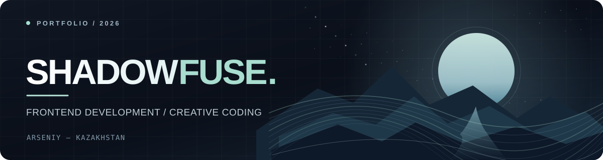
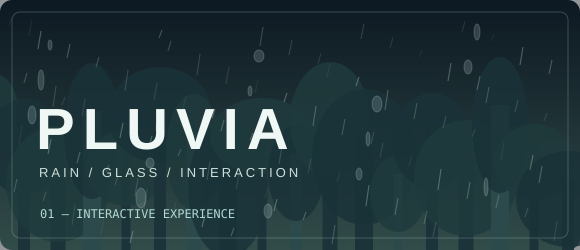
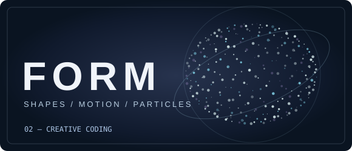

 

### Hi, I'm Arseniy 👋
**Frontend developer from Kazakhstan, exploring the space between design and code.**

I create responsive websites, interactive experiences and experiments with motion.

  
  
  

 

<h2 align="center">✦ About Me</h2>

<table>
  <tr>
    <td width="55%" valign="middle">
      <h3>Design-minded. Code-driven.</h3>
      
I'm Arseniy — a frontend developer who enjoys building interfaces that feel alive. I care about composition, smooth interaction and the small details that make a website memorable.

      
My current focus is practical frontend development: responsive layouts, JavaScript interactions and creative web graphics.

      
🎯 <b>Goal:</b> join a web studio, contribute to real projects and keep growing as a developer.

      
📍 <b>Location:</b> Kazakhstan 
      💬 <b>Contact:</b> <a href="https://t.me/ShadowFuse">@ShadowFuse</a>

    </td>
    <td width="45%" valign="middle">
      
    </td>
  </tr>
</table>

 

<h2 align="center">⚙️ Technologies & Tools</h2>

  

**Core:** HTML · CSS · JavaScript &nbsp; | &nbsp; **Exploring:** React (basics) · Three.js  
**Workflow:** Git · GitHub · VS Code · Figma &nbsp; | &nbsp; **Also:** Tilda · Canva · Photoshop

 

<h2 align="center">✧ Selected Work</h2>

<table>
  <tr>
    <td width="50%" valign="top">
      
      <h3>01. Pluvia</h3>
      
An atmospheric rain-on-glass experience featuring a forest scene, animated droplets, cursor interaction, sound states and a clearing effect.

      
<code>HTML</code> <code>CSS</code> <code>JavaScript</code>

      <a href="https://shadowfuse.github.io/portfolio/#work">View showcase ↗</a>
    </td>
    <td width="50%" valign="top">
      
      <h3>02. Form</h3>
      
A space-themed creative coding project with interactive particle shapes, smooth transitions and scroll-driven motion.

      
<code>JavaScript</code> <code>Web graphics</code> <code>Animation</code>

      <a href="https://shadowfuse.github.io/portfolio/#work">View showcase ↗</a>
    </td>
  </tr>
</table>

<b>More work — Dobro Medical Group</b>

 

A medical equipment website design with a striking hero section, clear product categories and high-contrast visual hierarchy.

<a href="https://shadowfuse.github.io/portfolio/#work">View website showcase ↗</a>

 

<h2 align="center">◈ GitHub Activity</h2>

 

GitHub statistics are generated from public repository data and may update with a delay.

 

---

### Let's build something interesting.

Interested in junior frontend work, web studio collaboration and small website projects.

[**View Portfolio**](https://shadowfuse.github.io/portfolio/) &nbsp;·&nbsp; [**Contact on Telegram**](https://t.me/ShadowFuse)

Built with curiosity, patience and a lot of iteration.

