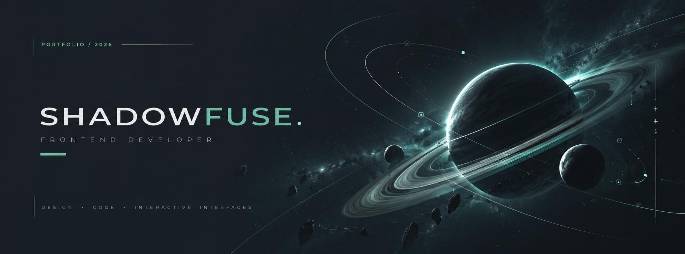
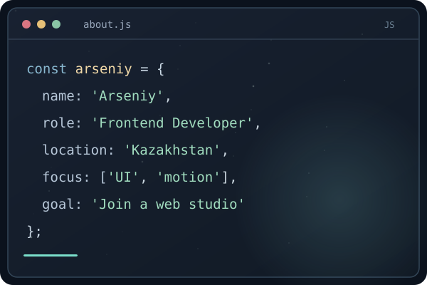

 

### Hi, I'm Arseniy 👋
**Frontend developer from Kazakhstan · Creative coding & interactive interfaces**

I build responsive websites, experiment with Canvas graphics and make interfaces feel alive.

  
  
  

 

<h2 align="center">✦ About Me</h2>

<table>
<tr>
<td width="55%" valign="middle">

### Design-minded. Code-driven.

I'm Arseniy, a frontend developer from Kazakhstan. I enjoy turning visual ideas into responsive interfaces — especially projects involving interaction, animation and creative coding.

I work with **HTML, CSS and JavaScript**, and I'm expanding my experience with React and modern frontend workflows.

**Currently looking for an opportunity to join a web studio**, collaborate on real projects and grow as a developer.

📍 Kazakhstan  
💬 [@ShadowFuse on Telegram](https://t.me/ShadowFuse)

</td>
<td width="45%" valign="middle">

</td>
</tr>
</table>

 

<h2 align="center">⚙️ Technologies & Tools</h2>

  

**Frontend:** HTML · CSS · JavaScript · Canvas 2D · React basics  
**Exploring:** Three.js · Creative web graphics  
**Tools:** Git · GitHub · VS Code · Figma · Photoshop · Tilda · Canva

 

<h2 align="center">✧ Featured Projects</h2>

<table>
<tr>
<td width="50%" valign="top">

### 01 / Pluvia

Rain on glass. Interactive droplets, fog and sound.

HTML · CSS · JavaScript · Canvas 2D

 

</td>
<td width="50%" valign="top">

### 02 / FORM

An interactive space experience built from particles.

HTML · CSS · JavaScript · Canvas 2D

 

</td>
</tr>
</table>

<h3 align="center">Other Projects</h3>

<table width="100%">
<tr>
<td width="100%">

<b>03 / Dobro Medical Group</b> &nbsp;·&nbsp; Medical equipment website

 

Corporate website for a medical equipment supplier in Kazakhstan. Catalog, products and company information.

Corporate Website · Web Design · Frontend

</td>
</tr>
</table>

 

<h2 align="center">◈ GitHub Activity</h2>

 

---

### Let's build something interesting.

**Open to junior frontend opportunities and web studio collaborations.**

[**Portfolio**](https://shadowfuse.github.io/portfolio/) &nbsp;·&nbsp; [**Telegram**](https://t.me/ShadowFuse) &nbsp;·&nbsp; [**GitHub**](https://github.com/ShadowFuse)

Made with curiosity and attention to detail.

